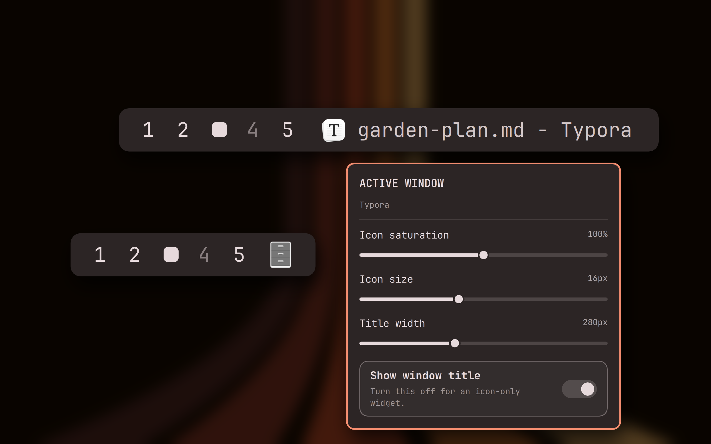

# crmne Active Window for Omarchy

A native Quattro/Quickshell active-window widget with the focused
application's actual desktop icon and its window title.



The preview shows the actual widget and appearance panel, rendered in an
isolated offscreen capture host with a synthetic window title and workspaces,
over Omarchy's Ristretto wallpaper. The icons come from installed desktop
entries (Typora, and Files at 0% saturation in icon-only mode). To regenerate
it on an Omarchy machine, run `tools/capture/capture.py` under an exclusive
GPU lock; it refuses a software-rendered capture, then
`tools/capture/compose.py` lays the renders out large enough to read in the
marketplace card's crop.

Icon lookup uses three pieces of runtime information, in order to handle both
normal applications and Chromium web apps:

- the active Wayland/Hyprland application class;
- Hyprland's initial class and process ID;
- the running process executable from `/proc/<pid>/exe`.

Those values are matched against Freedesktop desktop entries, including
`StartupWMClass`, and the matched entry's themed icon is rendered. Linux
Wayland windows do not carry a portable embedded icon themselves, so this is
the standard reliable route to the icon belonging to the running app.

## Install

```bash
omarchy plugin add https://github.com/crmne/omarchy-active-window.git --enable --yes
omarchy bar move crmne.active-window --section left --after omarchy.workspaces
```

## Requirements

- Omarchy Quattro with its Quickshell-based shell.
- Hyprland and standard Freedesktop desktop entries for application matching.

There are no additional packages, services, or helper scripts.

## Remove

```bash
omarchy plugin remove crmne.active-window --yes
```

For local development, put or link this repository at
`~/.config/omarchy/plugins/crmne.active-window` and run:

```bash
omarchy-shell shell rescanPlugins
omarchy plugin enable crmne.active-window --section left --after omarchy.workspaces
```

The Omarchy bar settings UI exposes icon saturation from 0% (grayscale) through
100% (the original icon) to 200% (boosted), plus icon size, title width, and an
icon-only toggle.

Left click activates the window, middle click closes it, and right click opens
an appearance panel. The panel previews and persists saturation, icon size,
title width, and the icon-only toggle directly in `shell.json`.
