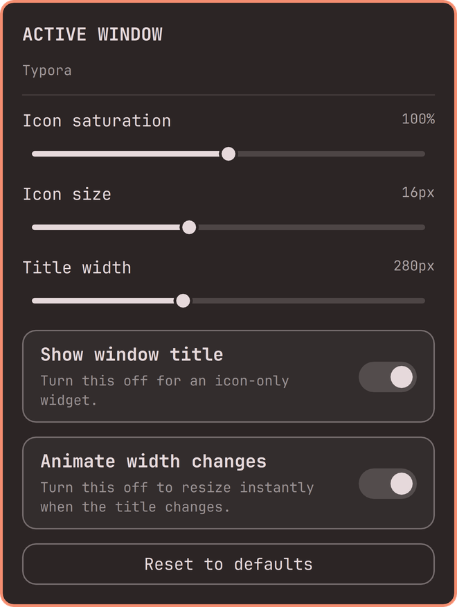

Two new controls in the appearance panel: turn off the sliding width animation, and put every setting back to its default in one click. This is the first release published on GitHub, so it also covers the fixes made since the v1.0.0 tag.

**Update** with `omarchy plugin update crmne.active-window`, or install with `omarchy plugin add https://github.com/crmne/omarchy-active-window.git --enable --yes`.

*The actual appearance panel, rendered offscreen with a synthetic window in the Ristretto theme.*

## New

- **Turn off the width animation.** The widget slides to its new width whenever the title changes. Switch off **Animate width changes** in the appearance panel (`animateWidth` in `shell.json`) and it resizes instantly instead. By @paixaomp in [#4](https://github.com/crmne/omarchy-active-window/pull/4), with an earlier version by @persidskiy in [#2](https://github.com/crmne/omarchy-active-window/pull/2).
- **The widget follows Omarchy's animation switch.** While Omarchy's animations are off (`omarchy toggle animations`), the widget resizes instantly too, like the rest of the shell. By @crmne.
- **Reset to defaults.** A button at the bottom of the appearance panel puts icon saturation, icon size, title width, the window title and the width animation back to their defaults in a single save. It is a standard Omarchy button, so it follows your theme. By @rafaelmehdiyev in [#1](https://github.com/crmne/omarchy-active-window/pull/1), with changes by @crmne.

## Fixed

- **Window titles and app names are always shown as plain text.** A title containing markup, such as `<b>` tags, is shown as written instead of being formatted. By @crmne.
- **No more color warnings in the shell's log.** On Omarchy 4.5 the appearance panel logged `Unable to assign [undefined] to QColor` every time it loaded. By @crmne.

## Known limitations

- Following Omarchy's animation switch needs Omarchy 4.5 or later. On earlier versions, only the widget's own **Animate width changes** setting turns the animation off.

## Thanks

- @paixaomp and @persidskiy, for the width animation setting
- @rafaelmehdiyev, for the reset button
- @crmne

**Full changelog**: https://github.com/crmne/omarchy-active-window/compare/v1.0.0...v1.1.0
